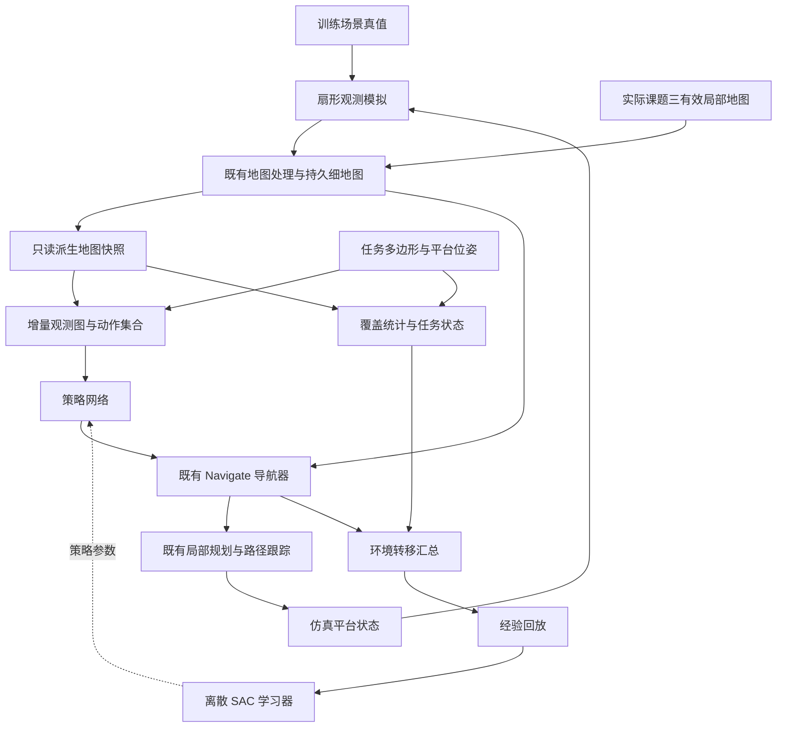

> 历史分支记录：`feat/drl-exploration-training` @ `c6473ae70eb4`。本文运行状态、接口和实验结论是当时快照；当前开发以 [统一入口](../../DRL开发入口.md) 为准。

# 基于增量观测图与深度强化学习的机器人探索完整设计

日期：2026-09-09。状态：**已实现，闭环采集、GPU更新及中断接续已验证；策略效果仍待完整评估**。

本文定义下一版探索策略、训练和推理架构。采用“增量观测图 + 位置与朝向联合选择 + 离散 SAC”，
替代旧版在任务尺度矩形中直接回归连续目标的策略；下发导航的接口仍为世界坐标连续位姿 `(x, y, yaw)`。
配置与实现状态见[验证记录](../../validation/2026-09-09-graph-viewpoint-exploration.md)。

依据为 `feat/drl-exploration-training` 工作树当前源码、
[原连续动作方案](2026-09-08-drl-exploration-complete-design.md)及
[已知空间导航设计](2026-09-09-known-space-navigation-design.md)。本文取代原方案的策略、动作、学习调度
和相应训练配置；地图来源、覆盖统计及导航契约继续复用，并在下文完整说明。
用户已授权按本方案实施；执行记录与运行证据单独维护，不能由设计文字推断训练效果。

## 1. 目标与设计决策

探索的决策问题是：**根据已经获得的地图，选择下一次移动和观测的位置及朝向，使任务范围获得尽可能充分的观测。**
未知区域是观测对象；平台的目标位置落在当前已知可通行空间。必要时先经过已观测区域到达新的观测位置。

| 项目 | 本方案约定 |
| --- | --- |
| 主要目标 | 覆盖率达到任务目标值；未达到时尽可能提高最终覆盖率，默认目标 95% |
| 次要目标 | 在覆盖效果接近时减少实际总路程；转动量作为小权重执行成本 |
| 任务输入 | 任务多边形角点、平台位姿、地图模块派生的可通行性与有效观测层 |
| 典型尺度 | 任务包围盒长边 100～300 m，最大约 1 km |
| 任务外运动 | 允许绕行；任务外观测不计覆盖奖励，任务外运动计入路程 |
| 平台运动 | 前进、后退、行进中转弯、原地旋转；无横向平移，线速度上限 0.2 m/s |
| 训练观测 | 默认 10 m、90° 扇形，考虑遮挡，参数来自配置 |
| 训练执行 | 复用现有导航器、规划器和控制器，8 个独立环境，目标仿真倍率 10 倍 |
| 时间语义 | 无探索任务时间上限；训练预算、通信超时与任务结束分开 |
| 自动保存 | 每 30 分钟墙钟时间，正常中断和退出也保存 |
| 产物 | 项目内专用文件夹，保留一个续训检查点、一个最佳策略及限长指标文件 |

不要求 Actor 学习车体动力学或障碍膨胀；不增加独立的候选安全认证服务、策略置信度门槛、失败黑名单、
覆盖停滞计数终止器或自动目标替换器。开发验证属于工程验证，不成为运行时的额外准入流程。

## 2. 选择该方案的依据

旧动作分布的支撑域是较大的连续矩形，而导航接受的是地图中形状不规则、不断变化的已知可通行集合。
探索早期已知区域很小，大量样本落入 UNKNOWN；这些目标会在运动前失败，产生大量低信息转移。
提高更新频率不能改变动作空间与导航契约的不一致。对输出做最近空闲格投影又会让网络动作与实际执行目标不同。

本方案直接对当前地图上的观测位姿集合建模。连续性保留在实际位置、朝向和导航运动中；策略输出改为动态集合上的
类别分布，动作索引只在当前决策快照内有意义。前沿与预测信息量是输入特征，网络学习去哪里、朝哪里看以及何时回访。

采用范围参考如下，工程方案并非论文的逐项复现：

| 资料 | 借鉴内容 | 本项目调整 |
| --- | --- | --- |
| [ARiADNE](https://arxiv.org/abs/2301.11575)及[作者代码](https://github.com/marmotlab/ARiADNE) | 用已知空间图表达探索，注意力网络选择下一步节点 | 增加扇形朝向动作，接入当前导航闭环 |
| [Large-scale Robot Exploration](https://arxiv.org/abs/2403.10833)及[作者代码](https://github.com/marmotlab/large-scale-DRL-exploration) | 图稀疏化与跨尺度决策 | 首版 Actor、Critic 均仅使用在线可得信息，不采用真值 Critic |
| [MARVEL](https://marmotlab.org/publications/77-ICRA2025-MARVEL.pdf) | 有限视野下联合考虑位置和朝向 | 单机器人、90° 视野；不引入多机器人通信或协同奖励 |

本文的覆盖定义、图构造细节、参数和职责划分属于本项目设计；上述论文不构成 1 km 场景性能或本项目覆盖达标的证明。

## 3. 系统结构与唯一职责



训练与实际运行使用图中不同的地图输入源，不同时运行两个地图生产者。

| 模块 | 负责 | 不负责 |
| --- | --- | --- |
| 既有地图模块 | 吸收有效局部地图，维护细地图、分类、代价、观测证据、epoch/revision | 选择探索目标、计算策略奖励 |
| `PolicyMapStore` | 接收只读快照/增量，构造策略所需视图 | 重做高程融合、车体膨胀或可通行性判定 |
| 观测图模块 | 用当前已知几何组织节点、连接、观测特征及动作集合 | 给出平台路线成功证明，选择最高分目标 |
| 策略网络 | 对位置和朝向联合动作给出分布，训练采样、推理取最大概率 | 改写地图、替换失败目标、发布速度 |
| 导航器及规划器 | 对选定目标规划、维护路线与局部段、响应地图变化，报告执行结果 | 自主探索前沿、决定覆盖完成、解释奖励 |
| 控制器 | 跟踪当前有效参考，执行前后运动和转动，发布平台命令 | 选择探索目标、维护第二套路线 |
| 覆盖/任务模块 | 面积统计、达标判断、估计穷尽状态 | 用策略候选数量替代可探索面积 |
| 环境与采集器 | 汇总真实执行转移，独立推进各环境 | 把更新次数视为采样次数或更改导航结果 |
| 学习器 | 从回放更新网络，发布参数、维护优化状态 | 驱动 ROS 执行循环 |
| 场景/观测模拟 | 生成真值、模拟视野与运动、判定仿真碰撞 | 将未观测真值提供给策略、候选图或在线覆盖排除 |

边界采用现有只读地图接口、导航 Action、`PathReference` 和 `TrackingStatus`。
图是探索包内部的数据结构，首版不增加 ROS 图服务，也不增加批量可达性查询。

## 4. 地图、任务范围与覆盖率

### 4.1 单一地图事实来源

策略使用细地图中的可通行性 `C(c) ∈ {UNKNOWN, FREE, BLOCKED}`、代价及有效观测层 `O(c)`。
有效观测层由既有地图处理链派生，策略不订阅课题三数据。`C != UNKNOWN` 不能代替 `O`：
膨胀可能把未观测格标成 BLOCKED，已有高程证据也可能尚不足以判断可通行性。

局部输入窗口与局部规划统一：窗口尺寸、位置、分辨率及有效范围直接采用导航快照的几何定义，
当前默认 64 m × 64 m、0.2 m。网络内部可卷积降采样，不能把重采样后的粗 FREE 当作目标落点依据。
导航窗口边界是视图边界，不是物理障碍或探索前沿。全局历史保留为增量图及稀疏分块数据，不拉伸进固定图像。

栅格以 `(map_epoch, world_grid_x, world_grid_y)` 标识。地图扩展、tile 重发及局部窗口平移不改变物理格身份。
epoch 切换清空本任务相关图缓存、历史观测及递归状态；若需延续任务，应由地图拥有者先提供一致的历史变换。

### 4.2 覆盖面积定义

令 `T` 为格中心位于任务多边形内或边界上的固定世界格集合，单格面积 `a = r²`；
`O_t` 为截至时刻 t 已有有效观测的集合，`X_t ⊆ T \ O_t` 为估计可排除的未观测集合。
任务外以及尚未分配地图存储的任务内格不因图裁剪消失。

| 指标 | 计算式 |
| --- | --- |
| 任务面积 | `A_T = count(T) a` |
| 已探索覆盖面积 | `A_O = count(T ∩ O_t) a`，含实际观测的障碍格 |
| 未观测面积 | `A_U = A_T - A_O` |
| 估计排除面积 | `A_X = count(X_t) a` |
| 估计可探索覆盖面积 | `A_E = A_T - A_X` |
| 估计剩余可探索面积 | `A_R = A_E - A_O` |
| 原始覆盖率 | `C_task = A_O / A_T` |
| 估计有效覆盖率 | `C_eff = A_O / A_E` |

保证 `0 ≤ A_O ≤ A_E ≤ A_T`。空任务属于无效输入，不以零分母计算完成。
新增奖励仅来自 `A_O` 的真实增量，撤销/增加排除或图节点变化均不产生面积奖励。

### 4.3 不可进入与不可观测

不可进入区域仍可能可见，不能把“不属于当前 FREE 连通分量”全部从分母删除。
沿用 `closed_component_opaque_approx` 简化：在包含任务外绕行空间的地图上，把 FREE、UNKNOWN 当作潜在连通区域，
BLOCKED 当作二维屏障；只将不属于平台分量、且不接触开放地图边缘的封闭分量内未观测任务格加入 `X_t`。
稀疏地图空洞、未分配区域和任务边界保持开放语义，不构成人造围墙。

这是把 BLOCKED 近似视为不透明屏障后的估计。坡度、车体间距和低矮障碍可能阻碍通行却不阻碍视线，
因此始终同时报告 `C_task` 和 `C_eff`。排除可撤回，`C_eff` 允许下降；不接受该近似时配置关闭排除，`X_t = ∅`。
观测图的连通分量只用于组织移动动作，不参加排除面积计算。

仿真评估另外用真值估计 `E_ref = T ∩ ⋃ V(q)`：q 遍历平台可达的采样位置和朝向，V 包含可见障碍，
并允许任务外位置观察任务内区域。报告 `C_ref = |O_t ∩ E_ref| / |E_ref|`、采样步长和 `O_t \ E_ref` 面积。
该离线参考不进入策略或在线达标判断，也不宣称是连续空间精确上限。

## 5. 增量观测图

### 5.1 图的含义

`G_t = (V_t, E_t)` 是已知空间的几何摘要。节点表示可提出的观测位置或中转位置；边表示按当前细格几何存在连接，
携带估计长度与代价。边不包含可执行 `PathReference`，不证明终端朝向、运动方向转换和完整平台动作可行。
只有现有平台规划器生成的路线具有相应执行语义。

节点属性包括世界位置、相对位置、任务内外属性、访问记录、局部观测比例、方向性观测潜力及地图版本。
保留平台当前位置节点。节点不要求靠近前沿，也不要求即时信息收益为正；已知走廊和回访入口都可作为中转节点。

### 5.2 构造方法

首版面向当前轮式平台，用固定世界格组织细地图几何摘要：

1. 按默认 2 m 方块划分已分配细格；在每块内按已知 FREE 八邻域且禁止切角划分分量。
2. 每个非空分量选距块中心最近的实际 FREE 格中心作为代表节点，同距离按世界格坐标排序；
   相邻块只在存在真实细格跨界连接时连边。
   保存跨界细格对和块内连接长度，用于几何代价估计。两个代表点不必直线可见，不能直接用连线当路径。
3. 块内分量查询范围固定且较小；它只维护几何连通摘要，不调用 `Navigate`、全程平台搜索或局部轨迹优化。
   复用已有细格状态及通用邻接规则，不复制一套障碍膨胀、坡度或平台参数。
4. 平台当前位置作为临时起点连接到所在细分量。若处于启动盲区，起点连接复用导航共享的有界起点几何处理，
   不复制或扩大补丁规则。该结果只提供离开起点的临时连接，不把假设格改为真实 FREE 或已观测。
   当前位置只有在真实细格为 FREE 时才提供原地转动目标；UNKNOWN 起点不能因支持旋转被当作合法终点。
   没有有效定位/地图时保持原有等待输入状态；没有可用起点连接时明确报告输入/起点状态。
5. 新增观测更新 dirty 块及跨块邻接；地图状态撤回、分量分裂/合并也更新相关连接，不能只增不减。

每块可有多个节点，避免单纯 2 m 均匀采样漏掉细地图中已经存在的窄通道。这里保留的是该几何离散图的连通性，
仍不能保证平台能够经过其中每条连接；平台规划失败如实进入训练转移。

节点身份使用世界位置和出生代次，未变化节点沿用 ID；分裂、合并时失效旧节点并建立新节点。
ID 不用可变数组下标，旧 ID 不在同一 epoch 内复用。缓存依赖 dirty 块及相关边版本，地图扩展不整体重编号。

### 5.3 地图增长与全局编码

动作附近使用 2 m 级图；远处按固定 32 m 分块形成区域连通摘要，每个区域内部的不同细图分量分别保留，
跨区入口及连接关系不能仅因没有前沿被删除。已经走过且没有当前观测潜力的长走廊可以压缩为连接及累计长度。
这是图的层级表示，不另行建立一套粗可通行性认证。

网络读取局部细图、远处区域图和任务分块摘要。任务摘要保留尚未观测的任务分布，
即使该处没有 FREE 节点，也不会从全局上下文消失。任务摘要节点只参与编码，不可作为移动动作。
使用稀疏邻接消息传递及固定数量的全局汇聚 token，避免全图节点两两注意力的平方开销。

不按“信息收益最高的前 K 个节点”裁剪唯一入口，不把图节点数量变成覆盖分母。
内存占用按当前实际节点和边统计；1 km 场景需实测，不能根据网络输入长度可变就宣称计算成本不受尺度影响。

## 6. 位置与朝向联合动作

### 6.1 动作集合

每次决策从平台起点连接的图分量中取图距离不超过 `action_radius_m = 10` 的局部节点，
在当前位置真实细格为 FREE 时加入当前位置作为候选。
每个位置配 `heading_bins = 12` 个等间隔朝向，默认 30° 间隔，以当前平台朝向为零点。
较长的压缩连接在此处展开底层节点，不把远处节点吸附到任意近点。2 m 节点间距、10 m 范围均可配置。

动作 `a = (node_id, heading_id)` 映射为：

```text
goal.x, goal.y = snapshot.nodes[node_id].world_position
goal.yaw = wrap(snapshot.robot_yaw + 2π × heading_id / heading_bins)
```

Actor 对联合动作直接打分，不先用规则固定最有利朝向，也不添加连续残差头。
选择是离散的，下发给导航的坐标、朝向和最终控制仍是连续值。朝向采样精度是可以评估调整的近似。

只去掉不可用条目、重复位姿以及当前位置上位移和转角都在导航完成容差内的恒等动作。
不根据未观测面积阈值删除移动动作；零即时收益绕行和合理回访必须保留。
当前位置的非零转向保留，因为转动过程的扫视也可能产生观测，不能只看终点扇形判断无收益。

动作范围控制单次决策的空间尺度，与导航内部 64 m 窗口的路线分段不是同一职责。
探索层不生成局部参考路径，不设置“距远处目标必须单调变近”的约束。

### 6.2 方向性观测特征

对每个候选位置计算默认 36 个方向扇区的统计，随动作朝向组合出 90° 视野特征：
已观测比例、潜在未观测面积、其中任务内面积、到已知遮挡的距离。使用当前观测证据估计，不调用真值传感器。
对未知空间的可见收益仅是预测；若派生地图只有可通行性而没有可靠遮挡证据，明确使用 BLOCKED 遮挡近似。

图输出潜力特征而不以其阈值认证动作。真实新增面积始终由执行期间地图有效观测增量计算，
这样特征估计偏差不会直接变成虚假奖励或禁止进入某个方向的门槛。

### 6.3 快照与执行一致性

决策时冻结 `(epoch, revision, pose, graph, candidates, mask)`。策略选择的索引只对该快照解释一次，
随后保存物理目标；地图增长不能把相同索引解释成新的节点。重复位姿去重在采样前完成。

导航接收该物理目标后按已有最新地图与会话规则执行。地图变化造成失败时记录原动作、原目标及实际结果，
不把目标投影到最近空闲格、不重新采样后冒充原动作，也不添加动作执行前的第二轮全候选规划。
图快照用于学习一致性；不要求整个导航期间地图 revision 保持不变。

## 7. 状态编码与策略网络

部分可观测任务采用带记忆的高层策略，隐状态为场景真值，策略只能看到已观测地图及历史执行结果。
一次高层动作包含多个控制周期，因此执行过程属于可变时长的宏动作；学习按决策索引统计折扣。

| 输入组 | 内容与编码 |
| --- | --- |
| 局部细地图 | FREE/BLOCKED/UNKNOWN、有效观测、代价、任务掩码、访问记录、有效窗口掩码；CNN |
| 图节点与边 | 相对坐标、类型、几何连接及长度、访问/观测统计；稀疏图注意力 |
| 全局任务摘要 | 多边形覆盖分布、区域未观测量、区域连通关系；分块 token |
| 平台与历史 | 朝向 sin/cos、上一动作、实际位移、转动量、导航结果；MLP + GRU |
| 传感器参数 | 量程、视角、安装偏角，作为条件输入，训练和推理同一格式 |
| 候选动作 | 位置、相对朝向 sin/cos、图距离、方向性观测特征及所属节点嵌入 |

位置同时提供米制相对距离和按传感器量程归一化距离，不仅用任务对角线缩放所有局部量。
全局位置采用任务参考原点与尺度；地图扩展不改变任务坐标基准。输入不包含未知真值、真值可观测上限或未来路径。

初始结构：局部 CNN 输出 128 维；稀疏图编码 3 层、token 128 维；32 个全局汇聚 token；GRU 256 维。
候选嵌入与局部、全局及记忆特征融合，经共享打分头输出每个联合动作的 logit。
变长集合采用 packed 表示或 batch 内 padding，padding 仅用于计算屏蔽，不作为“无效动作”提交环境。

Actor 与两个 Critic 使用同样的输入契约，但各自持有可训练编码器，避免共享参数被多个优化器重复更新。
两个目标 Critic 采用软更新。各 Critic 输出当前快照全部动作的 Q 值，而不是给固定编号分配永久含义。
推理只加载 Actor 和特征归一化定义；Critic、回放和真值环境不参与部署。

## 8. 导航动作、任务结束与异常

### 8.1 一次转移

```text
取最新完整派生状态 → 构图与生成候选 → Actor 选择一次目标
→ 既有 Navigate 执行，期间持续观测和积累实际路程
→ 导航到达或正常失败 → 汇总观测、运动与最终状态
→ 写入一条转移 → 同一环境立即开始下一次决策
```

导航保持已知空间契约：选择目标后只走正常平台规划链，导航内部不再自主换成前沿。
规划成功证据采用 `planning_outcome=0`、`reason_code=PLAN_FOUND`、`has_reference=true`；
任务动作完成还需对应执行结果，不能把发布过一条路径当作到达。

初始观测已达到目标时，直接记录零动作完成，不生成奖励或回放转移。
面积和路程从动作开始前快照累积到动作结束后的最终地图快照，包含途中观测及失败前的移动。
每段地图增量和里程只归属一条转移。启动时已观测面积作为 episode 初值，不免费计入首个动作奖励。

### 8.2 状态分类

| 情况 | 任务与学习处理 |
| --- | --- |
| 达到目标覆盖率 | 任务 `TARGET_REACHED_ESTIMATE`；终止，保留原始覆盖率和估计排除量 |
| 未达标且已有保守穷尽证据 | `EXHAUSTED_ESTIMATE`；终止并报告未达标，不伪装为成功 |
| 普通目标无效或平台 NO_PATH | 结束当前宏动作，保留转移，探索 episode 继续 |
| 真实仿真碰撞 | 终止该 episode，记录碰撞及已发生运动；不修改地图掩盖失败 |
| 明确取消 | 保留已完成转移；任务记取消，不计覆盖成功 |
| 通信/进程故障、资源不足 | 基础设施异常，不赋予探索不可达或成功语义 |
| 人为采样预算/评估预算到期 | 标记截断，不能作为策略完成或失败标签 |

穷尽判定复用 `exhaustion.py` 对剩余潜力的保守估计，不以候选集合为空、连续失败、最近面积不变或更新次数判断穷尽。
仅在宏动作间的稳定状态检查。若候选为空，先区别地图输入未就绪、任务穷尽与图表示异常；
不能生成一条全零概率的动作。存在尚未处理的地图增量时更新一次；仍无动作且不能证明穷尽时报告 `NO_CANDIDATE`，
暂停该环境并保留诊断，不用持续重置制造训练数据。其余环境继续。

真实探索任务不设置决策时限。训练采集器独立设置每场景256个完整目标动作的采样预算，
在宏动作返回后标记`truncated=True, terminated=False`并换图；真实后继图保留用于bootstrap，
原导航结果、面积奖励、路程成本不变。此边界只管理训练样本分配，不证明任务穷尽或策略失败。
回放的burn-in/unroll序列分段仍只影响采样，不主动重置平台。
平台故障看门狗只诊断执行/通信故障，不把“长时间没有新增面积”解释成任务结束。
异常发生前若缺少可确认的后继状态，该不完整动作不训练；不伪造一个终止后继状态来消除 bootstrap。

## 9. 奖励与学习目标

### 9.1 可解释的奖励

使用固定物理参考量归一化，而不除以随排除变化的 `A_E`：

```text
A_ref = 0.5 × R_ref² × FOV_ref_rad = 78.54 m²   # 10 m、90° 的标称扇形面积
L_ref = 10 m
r_t = ΔA_O / A_ref
      - λ_L × ΔL / L_ref
      - λ_θ × ΔΘ / (2π)
      - λ_F × I_normal_navigation_failure
      - λ_C × I_collision
      + λ_S × I_first_target_reached
```

`ΔL` 为实际平面轨迹弧长，倒车、绕行、任务外运动均累计；`ΔΘ` 为实际绝对转角累计，不能用首尾朝向差代替。
小转动成本用于区分反复空转和有效观测，不按墙钟或仿真秒惩罚探索时间。
同一终止事件的普通失败惩罚不与碰撞惩罚重复累计，成功奖励每个 episode 只给一次。
碰撞与覆盖达标同一转移发生时按碰撞终止，不再给成功奖励。

初始建议 `λ_L=0.01`、`λ_θ=0.001`、`λ_F=0.05`、`λ_C=5`、`λ_S=5`，面积权重为 1。
这些是归一化后的新参数，不能照搬旧版面积权重 100。
传感器配置变化时参考归一化常数仍固定在本训练版本中，避免同一覆盖面积的价值随配置漂移。

不奖励靠近前沿、减少目标欧氏距离、得到 PLAN_FOUND、访问未访问节点或缩小覆盖分母。
奖励优先鼓励真实新增面积，路程权重较小；有限权重和折扣不能数学保证严格字典序最优，
最终模型按成功率/覆盖优先、成功任务达标路程次之选择，不能只看平均训练回报。

### 9.2 变长离散 SAC

在当前有效集合 `A(s)` 上使用 masked categorical；合法动作概率之和为 1，无效 padding 概率为 0。
对 padding 不计算 `0 × log(0)`。只有一个动作时熵为 0，跳过该样本的温度更新；空集合不进入 Actor。

```text
V_target(s') = Σ[a'∈A(s')] π(a'|s') [min(Q1_target,Q2_target)(s',a') - α log π(a'|s')]
y = r + γ × bootstrap_mask × V_target(s')
L_Qi = E[(Qi(s,a) - stop_gradient(y))²]
L_actor = E[Σ[a∈A(s)] π(a|s) (α log π(a|s) - min(Q1,Q2)(s,a))]
```

Actor 更新时 Critic 参数不求梯度。目标使用后继状态自己的候选集合，不复用当前 mask。
覆盖完成、估计穷尽和碰撞的 `bootstrap_mask=0`；普通动作失败为 1；有有效后继状态的采样截断为 1。
对不具备合法后继动作且不是任务终止的异常转移，不计算上述目标，留在诊断而不强行设为 terminal。

温度用目标熵 `H_target(s)=η log |A(s)|`，初始 `η=0.3`、`α=0.01`，不沿用连续 SAC 的 `target_entropy=-3`。
通过温度优化让实际熵趋近目标熵；动作数随地图变化时记录归一化熵 `H/log|A|`，避免把动作变多误判成策略更随机。
推理采用最大概率动作，不使用熵奖励驱动实际随机游走。

任务无固定时限，持续正熵回报可能让学习器偏好继续游走而不结束 episode；推理取最大概率并不能消除已学 Q 值中的偏差。
因此把熵明确作为训练早期的正则：温度上限初始 0.02，预热后新转移数从 25000 到 100000 时线性减到 0，
实际温度取自适应温度与该上限的较小值。上限为 0 后停止温度优化，Bellman 目标和 Actor 损失均去掉熵项。
该初始日程可通过训练配置调整并随检查点恢复；不由覆盖停滞事件触发，不增加运行行为限制。
评估按不含熵的任务指标进行，同时检查回访、空转比例；温度退火并不替代策略收敛验证。

折扣默认 `γ=0.999`，按高层决策次数计算，不按执行秒数或 10 倍倍率折扣。
它仍对遥远决策收益有轻微折扣偏好，需用长走廊与绕行评估检查；没有时间限制不等于可以忽略折扣带来的偏差。
若长程学习受明显影响，再对折扣做有记录的实验，而不是加方向进度硬约束。

学习率 `1e-4`、目标软更新 `τ=0.005`、梯度裁剪 10；序列 batch 初始 8，burn-in 8、训练展开 16。
回放序列必须来自同一环境同一 episode，不能跨重置拼接；burn-in 不计损失，短序列使用显式有效位。

## 10. 训练环境与地图来源

### 10.1 场景与观测闭环

首版不使用 Isaac Sim/Isaac Lab，也不需要下载地图或纹理资源。
复用程序生成的月表和单层熔岩洞：月表包含散布石块、坡地、坑缘及阻挡；洞穴包含通道、分叉、回环、死端和封闭区。
训练地图不是输入给策略的完整先验，只提供给场景、扇形观测与仿真碰撞模块。

以种子和生成参数重建场景，真值按几何对象及按需 tile 存储。场景活动范围包含任务、起点和生成的绕行通道，
边界不能被误当作已观测墙；若边界代表仿真容量限制，达到它属于环境限制。
不为保证 100% 覆盖删去封闭区，也不强制任务内所有 FREE 格相互连通。

每个环境独立维护真值、位姿、仿真时钟、地图、图、任务状态、导航与控制会话。
默认 10 m/90°、安装偏角 0°、观测频率 2 Hz；射线计入首次命中的可见障碍格，阻挡后的格保持未观测。
训练观测经过已有地图派生链，Actor 不直接读取射线或课题三原始消息。
二维不透明遮挡是当前模拟假设，不能据此证明真实洞穴高差、顶板或多层遮挡性能。

### 10.2 运动和仿真倍率

控制指令由既有路径跟踪器产生，仿真运动状态按该指令积分；不瞬移到候选点。
线速度绝对值不超过 0.2 m/s，侧向速度为 0；角速度和加速度约束继承统一平台配置。
物理积分步长 0.05 s，10 倍倍率通过调度更多物理步实现，不把速度或单步位移乘 10。
所有仿真相关节点使用该环境仿真时钟；模型更新、保存计时和性能统计使用墙钟。

仿真碰撞模块复用平台几何定义，在真值地图上判断真实运动碰撞；它与导航在已知地图上的规划检查用途不同。
不再额外加一层策略动作碰撞认证。10 倍是目标倍率，实际倍率随 CPU/ROS 负载测量显示。

### 10.3 训练分布

第一阶段使用 30～100 m 场景学习移动、转向和获得新增观测；第二阶段以 100～300 m 为主混合月表/洞穴，
第三阶段加入 300～1000 m 的长走廊、跨区域回访和任务外绕行。后期保留小场景，不按尺度完全替换训练分布。
阶段采样权重写入配置，可按累计新转移数改变，不以“先通过成功率门槛”阻止学习启动。

训练、验证、最终测试采用互不重叠的种子集合；同一场景变更起点或旋转后仍属于同一个数据划分。
首版不依赖专家数据；前沿与贪心策略仅作为评估对照。传感器参数首轮固定为 10 m/90°，
随后需要适应其他视野时在训练分布中显式随机化，不能仅因配置可改就宣称已获得泛化能力。

## 11. 采集、推理与学习调度

8 个环境固定保留。采集控制循环与学习循环解耦：采集器只等待已完成环境的结果，不等待全部环境凑齐。
学习器独立消费回放，一个环境完成导航后立即产生下一动作，不能等其余环境或一轮梯度更新结束。

首版采用一个 CPU 采集/推理进程、一个 GPU 学习进程，复用 8 个现有 ROS 环境进程组。
CPU Actor 使用独立参数副本，可以合并同时就绪环境进行推理，但不为凑满 batch 延迟就绪环境。
线程资源在进程间分配，不能让每个环境各自启动 8 个 PyTorch 算子线程。
初始学习器 intra-op 8、interop 1；采集推理 intra-op 2；不启用额外 DataLoader worker。

学习器每 32 次更新发布一份最新 Actor 参数；参数通道只保留最新版本。
采集器在动作边界切换版本，以最多最近 8 步有效观测重算该环境记忆，避免直接沿用旧网络隐状态。
这是有限历史近似，训练使用相同长度的 burn-in；不承诺与重放整个 episode 的隐状态严格相等。

前 256 条正常完整转移采用候选集合内均匀采样，用于建立回放；这些暖启动样本不形成待补偿更新债务。
随后每条新转移产生默认 1 次更新额度，额度上限 32；学习器跟不上时丢弃超额更新额度而不丢弃采集事件。
允许有回放时消费已有额度，耗尽就等待新转移；禁止采样暂停后无限重复更新同一小段经验。
这里限制的是优化调度，不是探索行为、候选准入或任务完成条件。

转移传输队列有界，初始 64 条；长时间满载先停止派发新宏动作，已在执行的导航正常收尾。
显示队列背压，不静默丢弃执行结果。回放达到预算则按序列淘汰最旧经验；回放容量与通信队列职责不同。

终端进度显示每个环境的 `A_O、A_E、C_task、C_eff`、episode 路程、上一步新增面积、动作结果、候选数；
全局显示采集转移/s、更新/s、新转移数、更新次数、队列深度、回放占用、实际仿真倍率、Actor 版本及保存倒计时。
`transitions/s` 是每墙钟秒完成的宏动作转移数，不是速度、物理步频或地图更新频率。
无总采样预算时显示累计量；有预算时显示采样进度条，不显示虚构的“训练收敛百分比”。

## 12. 回放与中断接续

### 12.1 回放的数据语义

每条转移至少保留：episode/环境标识、动作前后观测引用、候选及 mask、实际所选节点/朝向及物理目标、
奖励分项、实际里程与转角、导航结果、terminal/truncated、地图版本和 Actor 版本。
图的边长度与候选特征属于快照内容；训练时不能从最新地图重建旧动作集合或按新排序解释旧下标。

相邻状态采用不可变 tile/图块引用和写时复制；未变化数据共享，回放淘汰时按引用释放。
不为每条转移复制整张地图，也不能只保存带旧网络参数的节点嵌入来替代可重新编码的输入。
计费包括数组、节点、边、索引和共享对象的唯一实际占用，避免只统计张量容量却遗漏 Python 对象。

初始回放目标 8 GiB、上限 12 GiB；续训保存的回放子集最多 2 GiB。
保存优先选择完整的近期序列及其依赖，不能只截断字节使图引用悬空。

### 12.2 保存与恢复

每 1800 秒单调墙钟时间触发保存，与仿真倍率、episode 和梯度更新次数无关。
即使暂时没有新更新，也由保存调度检查计时；没有状态变化时可跳过重复写入，但显示下一次检查时间。
保存取优化步骤结束的一致状态，并固定回放前缀与计数；序列化在后台使用冻结引用，ROS 环境继续运行。
保存期间新收集的数据属于下一检查点，不能将其计数写进当前检查点而遗漏数据依赖。

`resume.pt` 包含 Actor、双 Critic/目标网络、优化器、温度、随机数状态、更新计数、课程状态、
输入与动作版本、归一化定义、有限回放及相应元数据。保存剩余更新额度但限制为既定上限，不按历史采样量重建债务。
`best.pt` 仅含推理所需 Actor、输入契约、配置及验证摘要。

正常 Ctrl+C：停止派发新动作，取消并等待当前导航按原链停稳，收纳已完整形成的转移，保存一次后退出。
进程被强制杀死或断电只能恢复最后一次成功保存；临时文件不取代有效 `resume.pt`。
写入同目录临时文件，完成并同步后原子替换，磁盘空间不足时保留上一个检查点并明确显示本次保存失败。

恢复加载学习状态与有限回放，8 个环境开启新 episode，不恢复 ROS 进程、半条轨迹或完整仿真现场。
因此“接续训练”表示接续参数、优化器和部分经验，不表示机器人回到中断时的精确姿态。
新 episode 的 GRU 从零开始；旧回放仍按其 episode 边界训练。

连续动作检查点与本版联合离散动作不兼容，迁移时新建训练版本；不静默转成新回放。
兼容检查仅针对动作/特征/奖励语义、模型结构及必要地图坐标契约；线程数、存储路径、日志长度、保存间隔等
运行选项不应成为禁止续训的理由。配置版本信息内嵌检查点，不额外保留一套逐次 manifest 文件。

### 12.3 产物与预算

目录固定在项目内 `training-output/drl-exploration/`，不提交 Git：

```text
training-output/drl-exploration/
  resume.pt       # 唯一续训检查点
  best.pt         # 唯一最佳策略，有完整评估后才生成
  metrics.jsonl   # 限长标量记录
```

沿用当前资源配置的总产物上限 20 GiB、指标文件 8 MiB；上限包括原子替换时旧文件与临时文件的峰值。
该上限是容量预算，不是必须填满或每次必须生成 20 GiB。不得按每 30 分钟创建一个历史模型文件。
默认不留 rosbag、视频、逐帧地图、独立回放文件、逐 seed 模型和无限 ROS 文件日志。
最佳模型在完整验证后先留内存，在定时/退出保存时一并落盘；评估摘要写入现有指标文件。

存储空间仅在写入时按实际预计峰值检查；不因为磁盘未满足任意空闲阈值而阻止策略推理或导航。
旧版固定 20 GiB 空闲保留量不作为新版本启动准入要求。
内存目标沿用主机训练数据约 20 GiB、GPU 约 10 GiB；实际占用需计入导航进程和采集模型，
优先缩减回放/训练 micro-batch 解决容量问题，保持用户指定的 8 环境。

## 13. 推理与实际项目接入

训练和推理使用同一地图适配、图构造、候选定义及 Actor 前向路径；差异仅是训练随机采样与推理确定性选择。
在线循环为：现有任务输入 → 派生地图与位姿 → 更新图 → 选择观测位姿 → 现有导航 → 更新覆盖与任务状态。
初始化只需要现有输入具备可用数据和模型格式可解释，不增加完整地图预扫描、全候选路径验证或人工策略批准步骤。

部署只需要 Actor 检查点和运行配置，不依赖训练真值、程序场景生成器、Critic、经验池或仿真环境。
课题三数据仍交给已有地图模块处理；控制器保持唯一速度命令发布者。
任务多边形用于覆盖及任务特征，不裁掉导航可用的任务外地图。真实传感器变化需按实际有效地图范围设置条件输入，
若超出训练分布，报告为泛化评估范围，不额外用置信度阈值阻止所有导航。

## 14. 源码落点与替换范围

下面是实现职责划分，不要求为每个数据类型创建一个 ROS 节点或独立包。
现有路径均相对 `ros2_ws/src/lunar_drl_exploration/lunar_drl_exploration/`。

| 文件/模块 | 设计变更 |
| --- | --- |
| `maps.py` | 保留只读地图拥有关系与局部窗口；导出 dirty 块/只读细格访问，衔接共享起点几何，移除策略对旧全局图像编码的依赖 |
| 新增 `observation_graph.py` | 图、区域摘要、增量更新、候选联合动作及方向特征；纯计算，不持有导航 Action |
| `contracts.py` | 不可变图/候选快照、联合动作和转移结构；定义版本 |
| `model.py` | 图编码与联合 categorical Actor，双离散 Critic，保留局部 CNN/递归输入理念 |
| `sac.py` | 离散目标、变长 mask、状态相关目标熵；移除连续动作 log-prob 修正 |
| `runtime.py` | 共用推理路径；动作只映射一次到物理位姿，保持正常导航事务 |
| `ros_env.py`、`worker.py` | 按宏动作汇总真实执行，报告任务终止和基础设施故障；采样截断由collector负责 |
| `training.py`、`processes.py` | 独立采集/学习调度，参数发布及有界队列；不再串行补更新债务 |
| `replay.py`、`checkpoint.py` | 图快照引用、序列依赖、30 分钟一致保存与有限回放恢复 |
| `reward.py`、`evaluation.py`、`progress.py` | 新奖励归一化、覆盖优先评估、分离采样/更新/执行进度 |
| `coverage.py`、`exhaustion.py` | 复用已有面积/穷尽职责，不将候选图接入覆盖分母 |
| `scene.py`、`visibility.py`、`plant.py` | 复用场景、观测与控制积分；补齐针对图策略的场景覆盖，不改变速度语义 |
| `config.py`、`config/drl_exploration.yaml` | 声明新动作/模型/奖励版本与对应配置，清除连续矩形尺度等失效选项 |

导航核心、`KnownSpaceRoutePlanner`、`LocalTargetSelector` 和路径跟踪器不因策略改版再次重构。
共享几何查询若需要补接口，应放在现有地图/几何所属层，不在 Python 中复制平台判定。
移除旧 DRL 路径的高斯 Actor、目标矩形缩放、失效连续熵参数及重复后处理；
独立传统前沿探索功能和评估基线仍可保留，不作为图策略失败后的隐藏回退。

## 15. 实施顺序与验证内容

先完成以下依赖顺序，具体代码实施另按任务执行；本节不增加运行准入状态机。

1. 实现不可变观测图、候选联合动作与版本契约，在静态/增量地图上验证几何和索引语义。
2. 接入现有导航，用同集合均匀动作跑闭环，确认移动、转向、覆盖归属和失败语义。
3. 替换模型、离散 SAC 与图回放，验证损失、mask、序列和保存恢复。
4. 分离采集/学习调度并接入进度显示，确认更新不阻塞各环境独立派发。
5. 按既定场景分布训练，在固定验证种子上选模型；测试集只做最终报告。

正确性场景与预期：

| 场景 | 需要看到的结果 |
| --- | --- |
| 初始小片已知区域、大任务多边形 | 移动候选来自已知细格，不随任务对角线扩散至 UNKNOWN |
| 起点盲区与真实 FREE 起点 | 临时起点边与导航规则相同；不把 UNKNOWN 起点作为旋转终点，不把起点补丁计入观测 |
| 单块内多条细窄通道 | 每个细分量保留代表，跨块实际连接不被采样间距抹掉 |
| L/S/U 形绕行、先远离目标 | 几何图表达连接，导航按真实平台路线执行，不要求欧氏距离单调减少 |
| 任务外绕行再进入 | 外部中转动作保留，外部路程累计、外部观测不计覆盖 |
| 原地扫视、途中转向 | 能选择非零转动，实际扫过的新面积计入，侧向速度保持零 |
| 封闭障碍与不可进入可见区域 | 可见障碍计覆盖；估计排除不等于已观测；图裁剪不改分母 |
| 地图扩展、块分裂/合并 | 历史动作仍指原物理位姿；不同版本候选不混用 |
| 图连通但平台规划失败 | 记录真实失败，不投影、换目标或永久拉黑 |
| 一动作、空动作、padding | 一动作概率 1；空集合有明确状态；损失无 NaN 和错误 bootstrap |
| 一环境长导航、其余环境结束 | 其余环境继续派发；GPU 更新不会使全部环境等待 |
| 序列跨地图更新和 episode | 快照可重算，episode 不串接，旧数据不依赖活图 |
| 保存、中断、空间不足 | 最多一份有效续训文件和必要临时文件；恢复语义明确；失败保留旧文件 |

算法比较包含：同一候选集合上的随机策略、同集合即时观测潜力/路程贪心策略，以及现有完整前沿方法。
前两个隔离学习收益，第三个比较完整系统；均使用相同导航、传感器、速度、地图种子和任务范围。

主要指标按覆盖达标率、最终 `C_task/C_eff/C_ref`、估计达标与参考达标偏差排序；
次要指标为达到同一覆盖目标的总路程及转动量。未完成样本不能与成功样本直接比较“路程更短”。
另外报告正常导航失败率、碰撞、空候选、采集吞吐、更新吞吐、实际倍率及内存峰值。
仅具有采样预算的评估若截断，报告截断比例及当时覆盖，不参与完整任务成功模型排名。

完整验证可在周期性冻结 Actor 后分批执行；8 个环境总数不增加，可在任务终止或训练采样截断边界临时安排验证任务，
验证期间该环境不写训练回放。其余环境继续训练，同一轮验证固定 Actor 版本，不能混用更新中的模型。
旧版 64 决策短测可作为链路诊断，不能据此选出宣称任务完成最好的模型。

源码测试、Jazzy 闭环、Humble 构建/闭环、Orin 和实车结果分别记录。
**本次仅完成设计文档；本版图策略的实现、训练效果、Jazzy/Humble 闭环及 Orin/实车验证均为 NOT_RUN。**

## 16. 必要校验与已删去的重复职责

保留的检查均位于数据或执行的原有拥有层：地图入口检查数据结构和 epoch 一致性；
图模块维护自身索引与几何连接；导航对实际所选目标执行正常规划；控制器维持既有有效参考和输入失效处理；
仿真在真值上判定是否真实碰撞。它们分别回答数据是否可解释、图是否自洽、路径如何执行以及执行结果是什么。

不增加“候选生成 → 批量导航预规划 → 策略选择 → 再预规划 → 导航”的链路。
候选 mask 表示当前动作集合和张量有效项，不是额外审批。模型加载只检查能否正确解释输入和动作，
不绑定无关资源配置，不设置需要先达标才能训练或推理的性能门槛。

本方案仍有明确近似：图几何不等于平台可达性、位置与朝向离散采样可能漏掉更优观测位姿、
BLOCKED 不透明近似可能影响覆盖分母、有限记忆和折扣可能影响长程决策、8 环境的 10 倍实际倍率取决于负载。
这些由可复现的失败和评估结果推动后续算法改进，不通过隐藏目标替换、删掉困难样本或新增行为禁令掩盖。

场景生成器版本2在三个固定起点构造局部平坦支撑地面：核心半径按平台包络和细格采样支撑范围确定，
默认约1.2844m，外侧2m平滑过渡，并预留对应岩石/洞壁空间。随机原始地形参数及任务范围保持确定性，
局部过渡范围外的地面不改变。该初始条件属于仿真场景，不向地图写入FREE标记；通行状态仍由原生地图派生。
支撑面保证起点具备放置条件，不保证场景全局连通或所有地形能够探索。日志记录生成版本、原生起点连接状态
和图起点状态。接续训练继续使用历史真实图经验，新episode使用新生成器，不混淆旧种子的场景版本。

2026-09-09采样调度修订：自动验证每案例默认1024个动作，预算截断后继续后续案例；训练预算默认256。
详见[采样预算验证](../../validation/2026-09-09-training-sampling-budget.md)。
