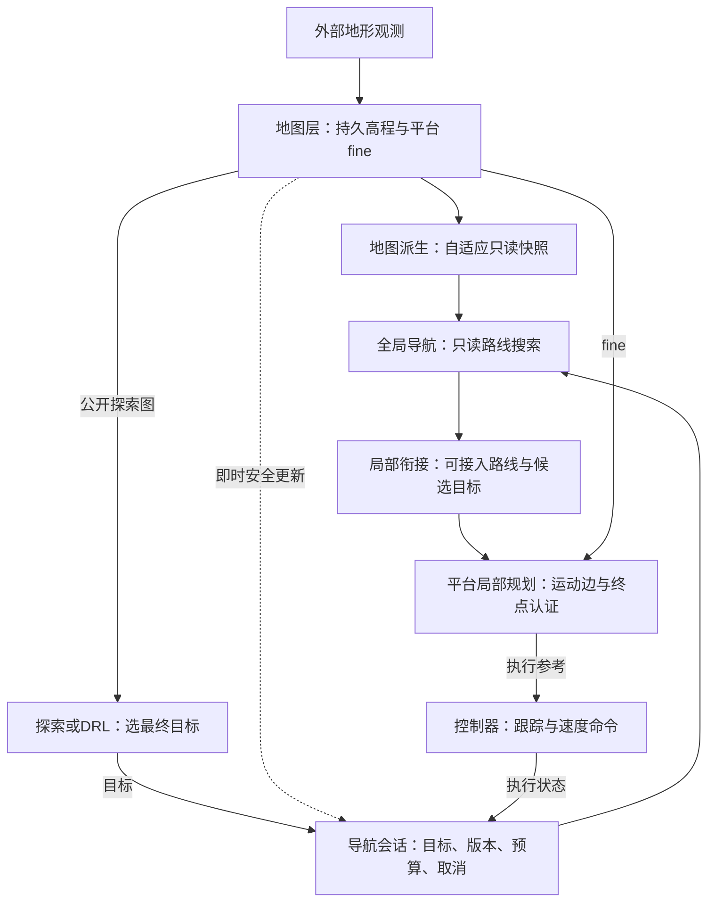

# 自适应导航职责与替换审核

审核日期：2026-10-15。对象为 `feat/adaptive-navigation-20261015` 在 `6868236f` 上的未提交实现，以及本地集成主线、三个应用分支和 DRL 分支的当前快照。本轮仅审核、记录和运行小型核心反例，未修改生产源码、合并、部署或改变正式训练。

**结论：基本分层合理，算法内核值得保留；当前不通过直接覆盖各应用分支的替换审核。** 独立审查确认三项 Important，另有两项较小的全局语义问题。19 个全已知静态场景的结果依然有效，但不覆盖生产包装器、在线部分地图和应用分支的持续滚动执行。

## 🔍 必须处理的发现

|编号|级别|发现|替换前要求|
|---|---|---|---|
|A1|Important|ROS `Instrument()` 丢弃 `select_target_controlled`，真实目标构造使用无 deadline/stop 重载|透传受控端口，增加经过真实包装器的测试|
|A2|Important|新 fine 发布后先构建自适应表示，再通知活动路径安全复核|将 fine 安全事件与表示就绪事件解耦|
|A3|Important 兼容阻断|未知目标时从原安全推进契约改为直接终止 `MAP_UNAVAILABLE/MAP_INSUFFICIENT`|明确并落实增量导航契约，验证现有调用方|
|A4|Minor|全局直达线与局部 supercover 对精确栅格边界的安全判据不一致|共享闭线段格接触判定，覆盖沿格线反例|
|A5|Minor|目标被已知闭合障碍圈封住，仍可能因起点分量触及未知边界而报告地图不足|收紧无路证据与未知分类，避免将保守判断当完整不可达证明|

A1 的位置为 [incremental_navigation_node.cpp:713](/mnt/data/WS/lunar-navigation/.worktrees/adaptive-navigation-20261015/ros2_ws/src/lunar_incremental_navigation_ros/src/incremental_navigation_node.cpp:713)。`RealSessionPorts()` 在 467–474 行设置了受控端口，但 `Instrument()` 仅转发旧 `select_target`，到 773 行返回时没有转发新字段。核心测试直接接入端口，因此其通过不能证明 ROS 包装后的控制令牌已经生效。超时后的协调器检查仍存在，但不能代替构造过程中的中断检查。

A2 的位置为 [incremental_navigation_node.cpp:850](/mnt/data/WS/lunar-navigation/.worktrees/adaptive-navigation-20261015/ros2_ws/src/lunar_incremental_navigation_ros/src/incremental_navigation_node.cpp:850)。`ElevationPipeline::RunFineDerivation()` 已将新 fine 发布，worker 随后同步构建自适应表示，最后才设置 `fine_changed`。活动引用的障碍失效依赖 1020–1022 行的 `OnFineSnapshot()`，普通里程计处理不能替代这一安全检查。因此表示构建可能将旧路径失效通知延迟接近 500ms 子预算。此项基于真实调用链确认；没有在本轮运行动态障碍闭环或测量设备停止距离。

A3 的位置为 [planning_session_coordinator.cpp:470](/mnt/data/WS/lunar-navigation/.worktrees/adaptive-navigation-20261015/ros2_ws/src/lunar_incremental_navigation_core/src/session/planning_session_coordinator.cpp:470)。32×32 地图仅 `x=2..12,y=2..10` 已知 FREE，起点 `(3.5,6.5)`，目标 `(26.5,6.5)` 未知时，真实核心结果为：

```text
legacy_coarse: PLAN_FOUND, local_calls=1, path_end_x=12.5
adaptive_known: terminal MAP_INSUFFICIENT, local_calls=0, no path
```

反例已分别使用当前源码与上一轮冻结的完整核心运行库复现，输出一致。严格已知空间搜索本身是合理能力，但将它设为旧 Action 的默认行为是接口语义变化。当前纯前沿调用方对 `MAP_UNAVAILABLE` 会等待新地图；静止等待不能保证产生新可观测区域。不能通过把 UNKNOWN 当可执行 FREE 来修复，也不能把选探索目标的职责搬进导航器。建议保留“最终目标不变、只执行已认证局部段”的增量导航契约，将未知指导、已知路线和可执行参考明确分开；如果选择只接受已知连通目标，则必须显式迁移调用方，不能宣称透明替换。

A4 的位置为 [adaptive_route_planner.cpp:125](/mnt/data/WS/lunar-navigation/.worktrees/adaptive-navigation-20261015/ros2_ws/src/lunar_incremental_navigation_core/src/global/adaptive_route_planner.cpp:125)。`row3=BLOCKED,row4=FREE`，连续路线 `(1.5,4)→(12.5,4)` 沿格边，返回 `KNOWN_ROUTE_FOUND`，公共 `VisitSupercoverCells` 返回 false。局部仍复核，不能从这个反例推断车辆碰撞；它说明全局“已知安全指导”与局部连接认证的规则不一致。

A5 的位置为 [adaptive_route_planner.cpp:383](/mnt/data/WS/lunar-navigation/.worktrees/adaptive-navigation-20261015/ros2_ws/src/lunar_incremental_navigation_core/src/global/adaptive_route_planner.cpp:383)。完全已知的闭合障碍圈围住 FREE 目标，起点分量触及地图外沿，结果仍为 `MAP_INSUFFICIENT`。这是无路证明范围偏保守，不是穿障碍证据。

## 📊 相对项目基线更改了什么

集成主线和三个应用分支的旧 `global_route_planner.cpp`、`local_goal_region.cpp` 提交内容逐文件相同。平台局部规划器、会话调度、配置及当前未提交的地图改动则不完全相同。

|部分|旧增量导航基线|改进实现|职责判断|
|---|---|---|---|
|地图依据|持久高程、fine 通行性和固定粗图|保留原 fine，额外派生不可变自适应区域快照|合理；不重建另一份环境事实|
|全局表示|固定粗格可能合并细尺度拓扑|均匀 FREE 区域合并、复杂边界细分，保留细格连接见证|地图派生职责；不接收任务目标|
|全局搜索|粗格 8 邻域加权 A*，启发权重1.5，起终点矩形加固定绕行余量，默认余量0|已知 FREE 区域 A*，全地图已知范围搜索；零附加代价直达可早退|更换搜索域/表达与约束，仍属于 A* 系列|
|未知区域|可作粗指导，局部认证决定实际执行段|全局已知路线不进入 UNKNOWN，证据不足单列|能力合理；增量默认行为有 A3 缺口|
|局部目标|最近几何投影可能隔墙接入未来路线|只检查窗口内合法直连，比较连接距离和余弧；检查后端点、垂足和起点|属于导航衔接，未改变上层最终目标|
|轮式/足式搜索|平台搜索和运动边认证|本次沿用，不用二维全局连通替代平台可执行性|合理；移植时保留应用分支的优化|
|执行控制|跟踪引用、转向限速、停止/反馈|本次没有引入新控制器|边界合理，速度命令仍归控制层|
|生命周期|原会话、地图更新、取消与预算|增加表示一致性/等待、可选新端口和诊断|需要修复 A1/A2；不应把重表示构建放到安全通知前|

新局部余路是有限合法连接的保守估计，不是连续可见域的精确最优。合法连接检查不会保证所有可见中间点都被枚举；目前不以此声称完备性。

## 📚 与主流探索基线的关系

项目的纯前沿设计引用了 FUEL/TARE。TARE 原作者实现本就使用局部密集、全局稀疏的分层探索；FUEL 使用增量前沿信息结构，依次做覆盖路径、局部视点与轨迹规划。[^tare] [^fuel]

本次改动没有修改这两个项目，也没有替换本项目的前沿检测、探索收益评分、任务区域、DRL Actor/Critic 或目标选择。改进位于给定目标之后的导航内核。上一轮性能对照对象是本项目旧导航，不是 TARE/FUEL 原作者实现；不能由现有实验宣称整体探索优于这些方法。

## 🗂️ 各应用分支的替换关系

|本地分支及提交|已有能力/差异|替换判断|
|---|---|---|
|`integration/pure-planner-orin@6868236f`|本改进直接基于此同步协调器版本|解决 A1–A5 和部分地图契约后可作为共享内核来源|
|`app/orin-real-vehicle@c4866408`|Prepare/Compute/Apply 异步滚动，执行反馈，专用 TF/硬件配置，局部单元缓存|不能用本版两个包整体覆盖；移植新表示/搜索/目标估价，保留调度和接入|
|`app/orin-unreal-simulation@17ebae41`|异步滚动及 TCP/仿真接入，平台局部缓存|与实车共用导航算法；仿真传输/时钟/控制接入继续由应用分支负责|
|`app/orin-legged-vehicle@0209ca23`|异步滚动、足式能力/控制接入、有向边认证及缓存|保留足式认证和硬件配置；尚无新版足式完整闭环替换证据|
|`dev/drl-exploration@31a4eacc`|GetPolicyMap 服务、精确终点容差、原地朝向/起步处理、轮式步进认证差异|替换时必须保留这些能力；当前实验节点没有 PolicyMap 服务，不能直接替代训练导航节点|

三个应用工作树当前分别有25/26/31项状态记录，包含尚未提交的地形观测估计、平滑、置信/观测空洞处理、局部跳变保护及配置修改。本轮只读捕获，未清理或覆盖。这些地图改动应继续留在地图层；新导航应消费其正式 fine 语义，不能以替换算法为由把它们重置到主线旧版本。

`NavigateToPose.action`、`PathReference.msg`、`TrackingStatus.msg` 在上述提交间逐文件一致，有利于保持线上的消息兼容。C++ `SnapshotBundle`、端口和会话接口已有变化，不承诺旧二进制插件兼容；需要在对应平台重编相关消费者，不能只复制 `.so`。三个应用分支的异步 `ComputeCycle` 必须真正调用新搜索，不能只给同步 `PlanCycle` 接上新端口。

还有两个不同层级的开关：`stack_mode=legacy|incremental_v2` 选择整套 `PlanMotion`/`NavigateToPose` 栈；`global_planner_mode=legacy_coarse|adaptive_known` 只选择增量栈的全局搜索。后者仍使用新局部评分，因此不是完整旧栈回滚。保留粗地图给探索发布使用也不等于继续运行旧全局搜索，两种用途应明确命名。

## 🔗 应保持的职责图

下图是审核后的目标边界；安全事件与表示就绪事件的解耦尚待落实。



地图层负责观测含义、地形估计、FREE/UNKNOWN/BLOCKED 和不可变派生，不判断探索任务完成。全局层的惰性邻接/门户枚举属于搜索状态生成，并未修改地图，无需为了表面分层强行预建所有邻接。局部目标是同一导航任务的中间执行目标，不是新的探索任务目标。导航会话负责把这些结果与最新状态、地图版本和执行反馈对应起来；控制器负责运动命令。

## 🛠️ 建议的最小整理顺序

1. 修复 A1 的端口透传、A2 的事件顺序和 A4 的公共几何判据，增加对应真实接线回归。
2. 对 A3 明确并保留增量导航契约：UNKNOWN 只能用于指导或等待，执行段必须认证；最终任务目标仍由调用方给定。分别验证未知目标、已知绕路、地图新增障碍、地图不足恢复。
3. 将自适应表示/搜索和局部连接估价保留为一套共享核心。在应用分支的异步 ComputeCycle 中接入，保留其 ApplyCycle 的最新地图复核、有效旧引用管理与执行反馈；保留 DRL PolicyMap 和终点处理。
4. 在各分支自己的地图生产者、平台配置和控制接入上验证。先做部分观测与持续滚动的 Humble 闭环，再做足式和目标 Orin；合并/部署按用户另行指定范围进行。

不需要为了替换再增加一层探索决策器、重写控制器或复制整套地图模块。应修复的是共享核心和接入边界，避免每个应用分支另养一份算法副本。

## 🧪 证据与限制

- 分支 SHA、提交与工作文件指纹、dirty 状态：[branch-matrix.json](/mnt/data/WS/lunar-navigation/analysis-artifacts/navigation-architecture-audit-20261015/branch-matrix.json)。
- 本轮审核源码指纹：[audited-source-sha256.json](/mnt/data/WS/lunar-navigation/analysis-artifacts/navigation-architecture-audit-20261015/audited-source-sha256.json)。
- 核心反例：[repro.cpp](/mnt/data/WS/lunar-navigation/analysis-artifacts/navigation-architecture-audit-20261015/repro.cpp)，直接链接上一轮冻结核心的结果：[repro-frozen-results.txt](/mnt/data/WS/lunar-navigation/analysis-artifacts/navigation-architecture-audit-20261015/repro-frozen-results.txt)。首次独立链接缺测试支持库的构建错误保留在 repro-build.log，修正链接后构建运行通过，不计作算法测试失败。
- 上轮 [19场景报告](/mnt/data/WS/lunar-navigation/analysis-artifacts/local-route-progress-20261015/report.md) 与核心17/17、ROS13/13 CTest 是已保存证据；本轮没有因源码未改而重跑全包测试，且指出其覆盖缺口。
- 较早 [150地图微基准](/mnt/data/WS/lunar-navigation/analysis-artifacts/adaptive-navigation-20261015/report.md) 已记录密集4096格岩石图的预算超时和约890.5MiB表示缓存峰值；不能用19个闭环场景推断任意地图的内存和硬实时上界。
- 动态地图失效时序闭环、部分观测完整任务、足式完整替换、原生Orin和实车为本次未验证项，不由静态审核或二维连通推断通过。

[^tare]: [TARE 原作者代码与分层说明](https://github.com/caochao39/tare_planner)。本轮实际读取。
[^fuel]: [FUEL 原作者代码与前沿信息/层次规划说明](https://github.com/HKUST-Aerial-Robotics/FUEL)。本轮实际读取。
