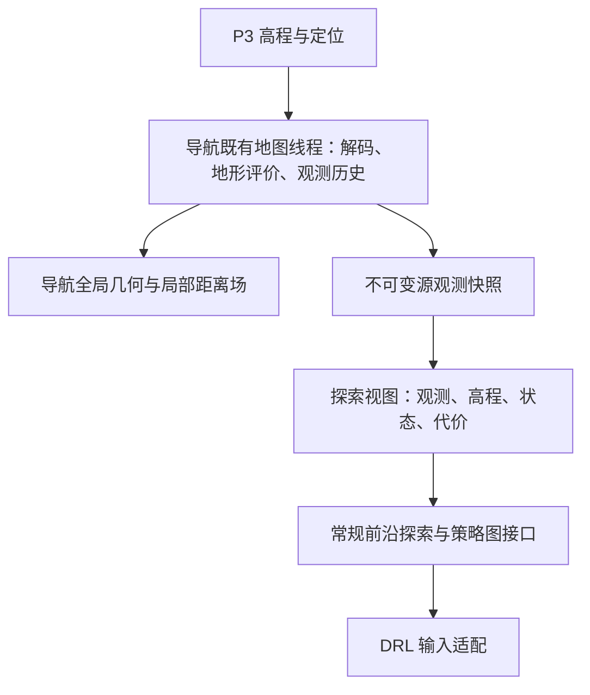

# 地图统一与分辨率配置

本专题的源码状态及验证边界见[验证报告](validation/2026-11-03-map-unification.md)。当前为已提交待目标验证、待合入；不是正式安装的运行说明。

## 分辨率来源

默认读取 P3 实际输入地图的 resolution，不按平台名字猜测。TCP 源图为 0.20 m 时派生 20 cm 图，实车源图为 0.05 m 时派生 5 cm 图。改 P4 参数不会改变 P3 建图精度。

|参数|默认值|含义|
|---|---:|---|
|policy_resolution_m|0.0|跟随 P3 源分辨率；正数强制指定策略图尺度|
|coarse_resolution_m|0.0|跟随有效 policy 尺度；正数保留旧版独立探索尺度能力|
|shared_map_facts|true|组合启动中启用唯一观测生产者|
|base_map_facts_topic|/Car/T4/mapping/base_facts|由 config/p4_topics.yaml 集中定义|

在既有 nav1cm_exploration.launch.py 启动命令后追加参数，例如：

```text
policy_resolution_m:=0.0 coarse_resolution_m:=0.0
policy_resolution_m:=0.20 coarse_resolution_m:=0.0
policy_resolution_m:=0.05 coarse_resolution_m:=0.0
```

第一行为自动模式，后两行为显式覆盖。设置 coarse_resolution_m 为不同正数仍支持保守聚合，不建议只因旧参数名而固定另一尺度。非法负数、非有限值不接受。源图尺度变化时，已有历史按世界坐标覆盖重新归并，不将旧数组下标当成新格坐标。格网几何变更会更新兼容版本，旧版本请求收到完整快照。

## 所有权与派生视图



共享的是源观测、几何和同平台地形测量，不强迫各消费者采用相同 UNKNOWN 规则。新 UNKNOWN 观测与导航保留的旧 BLOCKED 分类可以同时存在；探索只消费观测碎片，不拿导航保留分类冒充新观测。全局稀疏几何、局部 1 cm 计算网格及距离场继续作为算法视图；它们不代表 P3 源图被提高到 1 cm 精度。

同尺度、同格网边界时，探索粗/细图直接复用有效格网几何与内容，保留原消费接口与数据通道；不再额外重采样。错位、旋转或不同尺度时仍按覆盖面积保守聚合。浮点边界必须实际相等才能命中直接导出，否则走通用路径。

组合启动启用共享时，探索地图节点只订阅事实快照，不再独立订阅、解码、评价同一份 P3 地图。shared_map_facts:=false 保留旧版独立处理入口用于兼容对照。单独启动节点的事实话题默认空，不会隐式依赖另一个节点。当前组合启动仍会创建原有探索地图视图，不包含纯导航按需销毁视图的额外改造。

## 跨进程合同与版本

复用 std_msgs/String，schema 为 lunar-observation-facts/v1；没有新建 ROS 消息类型或地图管理节点。OccupancyGrid 无法表达测量与世界观测多边形，因此仅传该图不足以共享源事实。

快照包括源分辨率、frame、生产者 epoch、raw_revision、处理源时间戳、complete_snapshot 和观测多边形；每个碎片携带高度、坡度、起伏和观测状态。坐标统一为米，不传播 native handle。NaN 特征编码为 null。解析对版本、类型、重复键和范围做确定性校验。源时间戳受现有 ROS Time 的 int32 秒范围约束，不允许大整数静默回绕。

epoch/raw_revision 标识源事实；探索 fine/storage revision 标识派生存储，两者不混用。相同 epoch/raw_revision 不重新投影，仅刷新已有发布信息。几何兼容下沿用现有策略图版本接口；完整空快照撤销旧地图并输出 UNKNOWN。发布响应与兼容版本一起原子替换。

唯一生产线程成功提交地图后发布不可变快照。序列化或发布失败独立诊断，不回滚导航世界、不重复应用地图、不改变控制指令。接收端只保留最新待处理快照，由原工作线程处理；退出先停线程再销毁发布资源。

## 性能与适用边界

已实现同格网直接导出、重复源版本复用、历史受影响区域更新、未变化证据复用、包围盒筛选后精确相交。没有实现全链路增量传输：当前仍发送完整事实快照，变更快照的探索投影仍重建。大场景 5 cm 下的序列化、带宽、内存与端到端耗时必须在目标环境测量，不能用单元测试代替。

当前专题从 TCP 源码派生。现有 ExplorationMapNode 明确 LoadPlatformConfig(path, "wheel")，nav1cm 的配置加载同样采用轮式合同；5 cm 格网支持不等于足式入口已适配。足式应用需在所属应用线核对既有算法与能力配置，再做目标构建和 bag 验证。本轮不引入尚未验证的 Wermelinger/车体中心算法，也不修改 P3 或 Env_X。


## 起点观测与目标工具链修复

2026-11-03 用户裁决后，起点盲区不再拟合地面、补高程或生成假设FREE格。增量导航保留现有起点视图接口，但真实FREE才提供连接，覆盖列表始终为空；legacy planner直接使用真实local map，专用补图实现和缓存身份已删除。旧start_blind_zone_margin_m仅保留输入兼容，不再影响判定。此变更没有把UNKNOWN改成BLOCKED；UNKNOWN的规划策略仍归原有消费者处理，不能把补图删除理解为修改P3观测。

TCP速度来源仍是wheel基础能力与tcp_wheel_speed.yaml覆盖，本次保持0.1m/s、0.1rad/s，支持显式配置；发布器数量不是接口合同。

测试机GCC11.4的AArch64栈探测CFI缺陷已定位（官方PR119610）。本项目通过堆化工作数组、消除tile按值大参数将地形派生栈帧从1180768字节降为1376字节，保留默认stack-clash和stack-protector-strong。系统编译器未升级或打补丁；最小大栈复现仍反映该工具链缺陷，不能声称系统工具链本身已修复。应用构建应继续避免此类大栈对象。
